<div align="center">

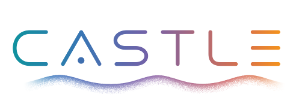

# CASTLE
### Classroom Adaptive Sandbox for Tactile Learning and Engagement

**An interactive, multisensory learning environment that turns physical sand into a responsive educational surface.**

**WVU Institute of Technology · Senior Capstone Project · 2026–2027**

*Status: In development — architecture, hardware design, UI concepts, and terrain simulations documented; full-system integration is ongoing.*

</div>

---

## Overview

<p align="center">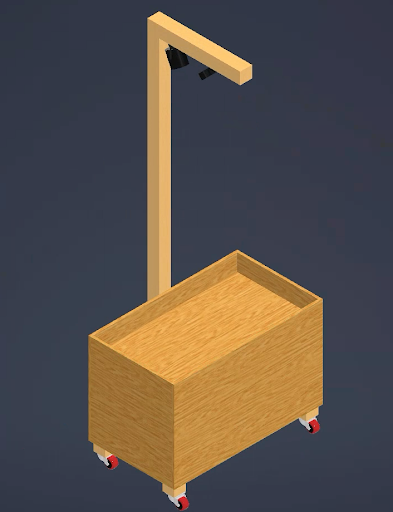</p>

*CAD concept of the CASTLE enclosure and overhead mounting structure.*


CASTLE is an augmented-reality sandbox being developed to support hands-on learning, particularly for neurodivergent elementary-aged students. Users shape a real sand surface while an overhead depth camera measures changes in the terrain. CASTLE processes those measurements into a digital model and uses a projector to overlay corresponding visuals onto the sand. The design also incorporates gesture-based interaction and audio feedback for educational activities.

The goal is to make educational content **tactile, visual, interactive, and adaptable** while giving educators a straightforward way to select and run lessons.

## How CASTLE Works

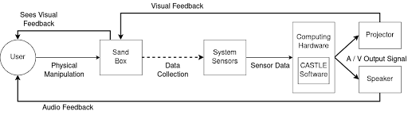

*System-level input/output diagram from the project documentation.*


1. **Sense:** Capture the sand surface and relevant user interactions.
2. **Model:** Process depth measurements to maintain a digital representation of the terrain.
3. **Interpret:** Let the selected lesson respond to terrain and interaction data.
4. **Respond:** Project lesson visuals onto the sand and provide audio feedback where appropriate.

Camera-to-projector calibration is central to making the projected graphics align with the physical sandbox.

## Planned Capabilities

- **Terrain-aware projection:** Visualizations that change as students raise, lower, or reshape the sand.
- **Hands-on lessons:** Educational activities designed around physical interaction and immediate feedback.
- **Gesture-based controls:** A projected interface designed for selection and navigation through hand input.
- **Modular lesson system:** Independently developed lesson plugins that use shared CASTLE interfaces rather than controlling hardware directly.
- **Multisensory feedback:** Coordinated projected imagery and instructional audio.
- **Classroom-oriented design:** A movable, lockable enclosure with protected access to internal electronics.

> These are design goals and planned system capabilities, not a claim that every feature is already operational.

## System Architecture

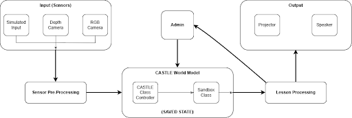

*Proposed World Model design connecting sensor preprocessing, system state, and lesson processing.*


CASTLE separates hardware interaction from lesson-specific behavior. The **C++ core** is responsible for sensor communication, depth processing, and maintaining the **Sandbox World Model**. Lesson modules consume data exposed by the core and generate activity-specific responses. The **Qt/QML interface** supports menus, lesson selection, and projected visuals.

### Software stack

| Technology | Intended role |
| --- | --- |
| **C++** | Core application, sensor processing, state management, lesson logic |
| **Qt / QML** | Menus, interactive interface, lesson visuals |
| **OpenCV** | Image processing and camera/projector calibration |
| **Orbbec OpenNI SDK** | Interface to the Astra Pro depth camera |
| **Debian GNU/Linux** | Planned deployment environment, with application-oriented startup |
| **JSON** | Lesson metadata, configuration, and simulation input |

### Lesson plugin architecture

Each lesson is intended to be a self-contained module, with its own behavior, visual presentation, settings, and assets. The core application will manage plugin discovery, initialization, activation, execution, and cleanup.

**Proposed lesson layout** (architectural design, not necessarily the current repository layout):

```text
example-lesson/
├── manifest.json       # Lesson identification and metadata
├── config.json         # Lesson-specific settings
├── LessonView.qml      # Projected lesson interface
├── icon.png            # Lesson-selection icon
├── assets/             # Lesson resources
└── src/
    ├── lesson.h
    └── lesson.cpp
```

The intent is to enable additional educational experiences without rewriting CASTLE’s sensor or terrain-processing systems.

## Hardware Design

| Component | Design selection / purpose |
| --- | --- |
| **Orbbec Astra Pro depth camera** | Overhead 3D sand surface measurement |
| **Mini projector** | Project visual lessons and terrain overlays onto sand |
| **RGB imaging** | Support hand tracking and gesture recognition |
| **Computing system** | Run the CASTLE application, process sensor data, and render output |
| **Arduino Nano / relay-based power controller** | Proposed coordinated power control for major components |
| **Wooden sandbox enclosure** | Sand basin, protected equipment compartment, and locking casters |
| **Audio output** | Educational cues and feedback |

The HLD specifies a **24 in × 42.67 in** sand basin and a nominal level sand-surface height of **26 in above the floor**. The preliminary structural design includes an overhead sensor/projector mount and an enclosed hardware compartment.

## Performance Goals

The current HLD sets a **proposed**, not yet validated, end-to-end response budget:

| Pipeline stage | Target budget |
| --- | ---: |
| Depth capture and delivery | 50 ms |
| Terrain processing and World Model update | 30 ms |
| Lesson execution | 10 ms |
| Rendering and projected display | 160 ms |
| **End to end** | **250 ms** |

These values are engineering targets subject to benchmarking and revision during hardware integration.

## Development Progress

The project documents currently show:

| Area | Documented progress |
| --- | --- |
| **Physical design** | CAD models, preliminary dimensions, structural load analyses |
| **Hardware planning** | Selected depth camera and projector; electrical power-system design |
| **Software architecture** | Defined C++/Qt approach, World Model concept, lesson-plugin design |
| **Interface design** | QML menu concepts and lesson-selection screens |
| **Terrain simulation** | Example simulated hills and craters with corresponding 2D topology output |
| **Integration and validation** | Still in development; full-system performance targets remain to be tested |

### Demonstrations and visuals

These are figures produced by the CASTLE team. The terrain examples below are **simulations** rather than live depth-camera captures or photographs of a functioning projection system.

#### Terrain simulations

| Simulated 3D terrain | Generated 2D elevation visualization |
|:---:|:---:|
| 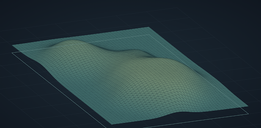 | 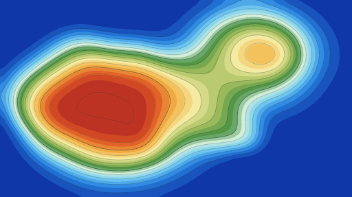 |
| *Terrain sample: hills* | *Topographic output: hills* |
| 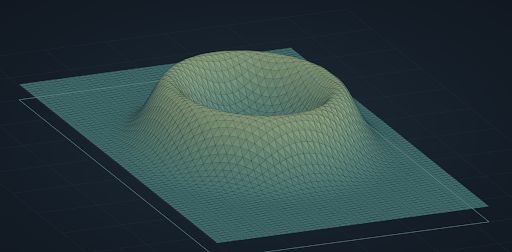 | 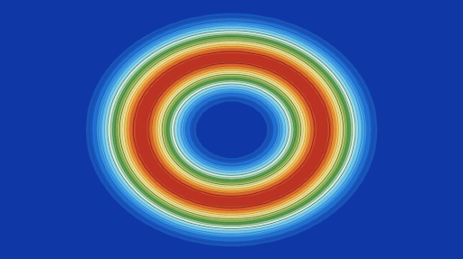 |
| *Terrain sample: crater* | *Topographic output: crater* |

#### Interface concept

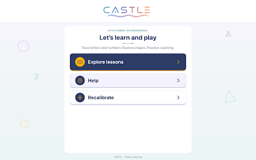

*Current home-menu design concept; interface details may evolve during integration.*

#### Depth representation

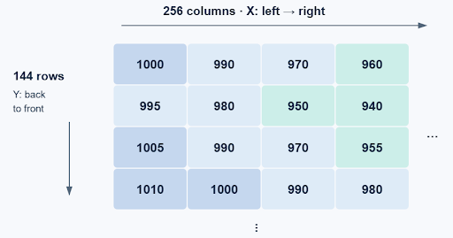

*Illustrative depth-value matrix showing the intended two-dimensional representation of measurements; the numbers are an example, not a measured camera frame.*

#### Hand-detection exploration

| Hand landmarks detected | No hand detected |
|:---:|:---:|
| 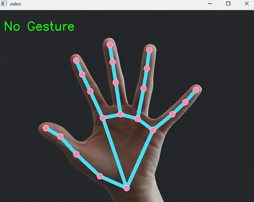 | 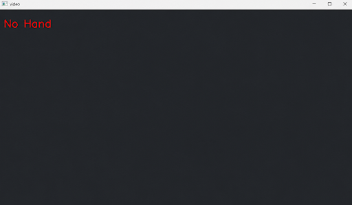 |

*Screenshots of an early hand-detection experiment. The “No Gesture” label indicates that these images do not establish completed gesture-classification integration.*

## Project Documentation

The engineering design is described in three companion documents:

- **System Overview** — Physical construction, hardware, software concepts, simulations, and initial bill of materials.
- **High-Level Design (HLD)** — System architecture, component choices, electrical design, application states, lesson plugins, and proposed performance budget.
- **Software Requirements Specification (SRS)** — Expected system behavior, interfaces, functional requirements, and nonfunctional requirements.

<!-- Add relative links once these PDFs are committed to the repository, e.g.:
[System Overview](docs/CASTLE-Overview_Report.pdf) · [HLD](docs/HLD_CASTLE-1.pdf) · [SRS](docs/SRS_CASTLE.pdf)
-->

## Team

Developed at **West Virginia University Institute of Technology** by:

**Alec Bailey · Brahm Keterson · Jacob Ferguson · Kinley O’Dell · Joe Ryan**

## Project Note

CASTLE is an academic capstone project under active development. Renderings, software diagrams, and specifications represent the team's documented design; individual components and performance measures may change as the prototype is assembled and tested.

## README Note:

This original README was generated using ChatGPT and has not currently been reviewed by a team member. It was pushed to github before editing to view it.
